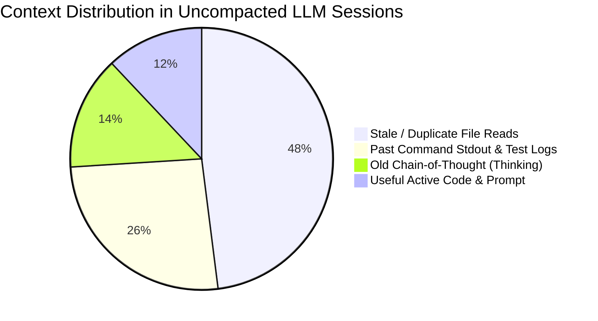

# contextWatcher (`cw`) — Empirical Evidence & Value Claims

## CW-122B1: Codex CLI mock qualification

[Qualification report](docs/CW-122B1-CODEX-MOCK-QUALIFICATION.md) and [sanitized aggregate](benchmark/cw122b1/mock-aggregate.json). The SHA-256-corrected run at `9525252be75be1d1e04825b5fc52404b10b316c8` used Codex CLI 0.166.0: 12 counterbalanced attempts, 48 requests, and 12 verified M2 transformations through the authenticated proxy to an in-process loopback mock. Independently recomputed SHA-256 digests match all 144 request/egress/response artifacts, 12 transcripts, and the campaign file. Fixture repairs and usage were scripted, so correctness advantage and product value remain NOT_EVALUATED. Raw evidence remains private outside the checkout. No provider inference, spend, production server changes, or changes to the frozen CW-122A campaign.

## CW-122B1-F1: Runtime fault injection

[PR #43](https://github.com/GionaGranchelli/context-watcher/pull/43), the [fault qualification](docs/CW-122B1-F1-FAULT-QUALIFICATION.md), and [sanitized matrix](benchmark/cw122b1/fault-matrix.json) record all 10 fault scenarios and all five partial-evidence boundaries passing on code commit `bdd3ba79714d5f1e34d94cdea5ed0df8840645cb`; matrix status is `READY_FOR_REVIEW`. The matrix SHA-256 is `a5ad0b91e85259f9053f6e9db3356338f185c14d461141052fa00b2bd3d174d1`. Private matrix evidence is at `/tmp/cw122b1-f1-matrix-bdd3ba7` (183 files `0600`, 51 directories `0700`); private matrix SHA-256 `390fcc56405d60004652a2cf5fbe918b88447f4727fd0775ead00b76be6e1da0`, and runner output SHA-256 `6454a56d4a0c560ffb0df4532b711b60bd405b23c939d3f383c4cb3e8b636621`. The separate [successful-path aggregate](benchmark/cw122b1/fault-success-path-aggregate.json) records 12 accepted Codex mock attempts, 48 requests, 12/12 independent acceptance checks and 12 M2 pruning treatments; its SHA-256 is `da6eea8645bc6fb9b7b95f572bbb0bf946f3a2dc886c25131c47d2d2352ca5ec`. Private success-path evidence is at `/tmp/cw122b1-f1-success-bdd3ba7` (173 files `0600`, 15 directories `0700`); its manifest SHA-256 is `fea04a8c2a08e721165fb52496c2cc9680ad288d3ffe3df63fa36217ad8eaef6`. Both private trees passed mode and symlink checks. The historical CW-122A freeze remains unchanged; its versioned F1 baseline is documented in the report. No provider inference or spend occurred. Live execution remains NO-GO; product value remains NOT_EVALUATED.

## CW-122B2-L0: Real-provider smoke readiness

[PR #45](https://github.com/GionaGranchelli/context-watcher/pull/45) is merged. Its L0 readiness report documents the real Codex → Context-Watcher → OpenAI requests, private wire/usage/ledger evidence, and the follow-up historical-prune request. The request-level observation is not a matched coding-task result; cache comparability and product value remain unqualified. No production server change occurred. The six-pair campaign remains disabled pending its separate authorization. See [the readiness report](docs/CW-122B2-L0-READINESS.md); raw evidence remains private.

## CW-122B2-L1: bounded real-provider smoke preparation

[Readiness report](docs/CW-122B2-L1-SMOKE-READINESS.md). PR #46 contains the bounded smoke runner and task-level M1/M2 integration. It now targets `main`; no full CI run is visible after retargeting (GitGuardian passed). Local full workspace verification and Clippy/formatting passed before the latest authorization edits; the current L1 authorization suite passes 13/13 in normal and optimized Python. The ignored Codex→CW→OpenAI pair compiles and binds separate approval to endpoint, GPT-6 Luna model, pricing/profile/campaign/runner/Codex hashes, credential hash, private evidence path, deadlines, 60-request cap and `$5` maximum. It was not run. One exploratory real request pair showed input 1,049→270 and request settlement `$0.000177`→`$0.000153`; all 20 private artifact hashes, shared ingress, byte-exact M1 passthrough, full M2 JSON diff, completed responses and pricing recomputation were rechecked ([sanitized evidence](.audit/cw122b2-l1/exploratory-pair-recheck.json)). It is one request-level observation, not coding-task value evidence. A second same-ingress observation has an incomplete M2 response at the 512-token output cap: input fell 74.26%, but output rose to 512 and settlement increased from `$0.000177` to `$0.000283`; driver and cache-state equivalence are unverified ([sanitized evidence](.audit/cw122b2-l1/same-ingress-incomplete-observation.json)). A model metadata preflight returned HTTP 200 without inference ([evidence](.audit/cw122b2-l1/provider-model-preflight.json)). PR #45 is merged. The prior private authorization draft is superseded and rejected because it used the old schema and did not accept overrun risk ([sanitized check](.audit/cw122b2-l1/smoke-authorization-draft-check.json)). Cache comparability and task-level product value remain NOT_EVALUATED; the six-pair campaign remains disabled.

The authorization replay finding is fixed: approval is bound to an exact GitHub-owner comment, and the atomic claim registry is fixed under the invoking OS account's home rather than supplied by the authorization. The cross-directory regression passes. This is local per-account single-use protection, not cross-machine coordination. The runner still defaults to NO-GO; real-provider tests remained ignored and unexecuted. No live approval comment or provider call was made.

## CW-122A: pruning-only offline readiness

[Preregistration](docs/CW-122A-PREREGISTRATION.md) and [readiness gates](docs/CW-122A-READINESS.md) define six matched M1/M2 pairs across two task families. A real proxy-to-mock boundary verifies exact historical PruneOrStub-only egress and its ledger; external oracles and matched analysis are rehearsed with synthetic repairs/usage. Product value is NOT_EVALUATED. CW-122B live-provider telemetry/cache fairness, fresh spend authorization and native M0 remain unqualified or closed. No inference, spending, production changes or historical rewrites.

## CW-122B2-L0: GPT-6 Luna smoke and pruning probe

[Operator workflow and security inventory](docs/CW-121C2-TUI-MCP-CONTROLS.md). Daemon-backed TUI controls require review and typed session confirmation; MCP policy inspection is read-only and rejects self-authorization attempts. Scripted real-PTY interaction verifies grant/revoke and terminal restoration, including API failure, using a separate local optimization database. 279 Rust tests passed (19 ignored), 15 web tests passed, and Clippy/formatting/Svelte check/build passed. Hermes plugin and offline lifecycle/admission tests passed. [Sanitized PTY evidence](.audit/cw121c2/terminal-smoke.json). Deterministic entry-failure tests verify raw-mode restoration without screen-control writes when alternate entry fails; the [updated PTY smoke](.audit/cw121c2/terminal-lifecycle-review.json) passed. Human visual usability remains unverified. No inference, production changes or historical evidence rewrites.

## CW-121C1: Operator consent workflow

[CLI/Web controls and verification](docs/CW-121C1-OPERATOR-CONSENT.md). Actual CLI-to-control-API tests cover explicit acknowledgement, revocation, session scope, terminated/Gemini restrictions, and failed responses. Web workflow tests cover stale sessions, acknowledgement reset and unavailable/unconfirmed state. The isolated terminal smoke passed and its daemon was stopped; [sanitized evidence](.audit/cw121c1/operator-check.json) records the outcomes and transcript hash. Browser interaction remains unverified: no browser provider was available. No inference, model-server execution, production changes or historical rewrites.

Validation: 269 Rust tests passed, 19 ignored; 15 web tests passed; Svelte check/build, workspace Clippy/formatting, 15 runner admission tests and the default offline fixture passed. Ignored harness/live suites were not executed.

## CW-121B: Consent-aware creation

[Creation contract, activation preview, and path inventory](docs/CW-121B-CONSENT-AWARE-CREATION.md). Offline core/store/API tests cover disabled/default and legacy policies, opt-in and revocation, non-pin preservation, manual inactive staging, transactional stale-grant and session protections, Gemini blocking, and inspectable activation scope. 265 Rust tests passed, 19 ignored; five web reporting tests, Svelte check/build, Clippy/formatting, and offline runner checks passed. Reporting distinguishes proposals from creation and measured savings. No inference, model-server access, historical rewrite, or production changes.

## CW-121A: PinContext application consent

See [policy contract and activation inventory](docs/CW-121A-PINCONTEXT-POLICY.md). The committed-pin regression failed before the runtime guard. Deterministic coverage verifies default-off, explicit opt-in, revocation, legacy rules, unchanged pruning, scoped consent, stored policy events, and application/abstention accounting. Validation: 257 Rust tests passed, 19 ignored; workspace Clippy and formatting passed; 15 Python admission tests and the offline fixture passed. This revision performs no provider inference or server changes. Broader activation UX and live-runner migration remain unqualified.

## PR #32 runner admission and identifier hardening

The runner now defaults to a sanitized in-process API fixture that can run from a normal checkout without OMP, PyYAML, provider credentials, a LAN endpoint, or private history. Live mode requires an affirmative flag and a current, single-use approval document recorded in the manifest. The endpoint/profile/evidence/history locations are explicit owner inputs; private historical replay remains owner-only, and the new fixture does not independently reproduce the historical measurements. Historical direct probe entrypoints are retired.

OMP imports now share the proxy's session-ID validator, preserving full UUIDs while rejecting unsupported canonical identifiers before persistence. Source transcripts remain unchanged. The original experiment results and historical freeze are retained; this safety change is not a new inference qualification or authorization.

## PinContext exposure diagnosis, offline only

The hashed patched trace contains the explicit M2 pin only on request 0 of 6. Its write occurs on request 3 without the pin; the original early brief remains present throughout. The rule is still committed. The transform operates on request copies, and the user-tail guard abstains on subsequent tool tails. This is one-shot reminder qualification, not persistent exposure or product readiness.

`benchmark/pin_exposure/diagnose.py` verifies the source hashes without network access. `crates/cw-proxy/tests/pin_lifecycle.rs` exercises the real transform API in-process, including eight tool follow-ups and later-user reapplication. The earlier invalid tool-pinned run is rejected. No new inference, production server access, or settings change occurred.

PR #33 merged the correctness fix and endpoint regression into main as `51b5710`. PR #32 now includes that reviewed main commit through a non-rewriting branch merge; the three correctness files have no remaining PR diff. Its initial two-file extraction now also includes a focused, in-process transform-endpoint regression. That regression fails against the pre-fix core and passes with the unchanged guard; full messages and zero applied pins are checked. Gemini contents-tail eligibility is tracked separately in #35, and empty user-text semantics in #36. The proposed four-arm pilot in `docs/PINCONTEXT-RETENTION-BENCHMARK.md` is not authorized or execution-ready. Its fixture/oracle/history/counterbalance gates remain open. See `.audit/pin-exposure/trace.json` and `docs/PINCONTEXT-EXPOSURE-DIAGNOSIS.md`.

## CW-104B recovery status

All 12 corrected CW-104A coding attempts finished. Recovery from per-run records yields six matched pairs; five have complete usage and clean transport. Their coding-only totals are M1 2,840.34 seconds / 426,553 input tokens and M2 2,385.39 seconds / 358,228 input tokens. These descriptive differences do not establish causality or a reliable performance advantage. The remaining pair retains its transport failures and missing usage. See `docs/CW-104A-RECOVERED-RESULTS.md`.

The user enabled server caching after CW-104A. Current enabled-cache counters must not be attributed to the historical uncached runs. Reserved-window initial reuse is now verified at 27,929 tokens per arm. The first genuine pair had invalid tool-output pinning. After a local fix and separate authorization, the replacement pair passed strict treatment/cache/acceptance gates; M2 used more time and tokens. See `docs/CW-104B-SMOKE-RESULTS.md`.

This document establishes the empirical justification, real-world benchmark data, and core value claims for **contextWatcher (`cw`)** prior to general availability.

---

## 1. Executive Summary & Core Claims

`contextWatcher` is an ultra-low-latency intercepting proxy, KV-cache prefix protector, and surgical context manipulation engine for autonomous LLM coding agents.

### The 4 Core Claims: Opportunity vs. Live Reality

1. **Context Bloat Reduction: Static Opportunity vs. Live Mutated Overlays**
   * *Static Corpus Opportunity (Identified):* Across **278 real developer sessions** analyzed across Antigravity, Codex CLI, Hermes, and Claude Code (totaling **19.92M tokens**), `cw`'s AST-based linter identified **14.33M tokens** (**71.92% bloat**) as cuttable redundant context (stale file reads, past command stdout, old thinking blocks).
   * *Active Proxy Execution (Measured):* In live sessions routed through the `cw` intercepting proxy, active overlays have pruned **153,789 tokens** with zero payload corruption, role disruption, or test regressions.

2. **KV-Cache Preservation: Conservative & Telemetry-Aware Prefix Protection**
   * *Claim:* Traditional context compactors (like naive turn truncation or LLM summary summarizers) break provider KV caches (Anthropic Prompt Caching, OpenAI Prefix Caching, Gemini Implicit Caching), resulting in 100% cache misses on turn $k+1$.
   * *Measured Reality:* `cw`'s Radix Prefix Differ and Optimizer isolate mutations by cache impact:
     - When cache hit telemetry is verified, `cw optimize min` (`cache_safe_boost`) selects strictly zero-break tail operations (`kv_break_tokens == 0`), preserving **100% of the cached prefix**.
     - When provider cache telemetry is absent or unknown, `cw` treats unverified prefix mutations as non-zero break, strictly preserving history and preventing unverified candidates from qualifying for `min`.
     - In **CW-117 Phase 1 (Cache-Aware Optimization Policy Engine)**, introduced formal cache-state classification (`WarmVerified`, `ColdLikely`, `Unknown`, `Rebuilding`) with evidence provenance, pure economic evaluation incorporating uncached re-reading and cache-write surcharges, and explainable decision gating (`Apply`, `Defer`, `Reject`, `NoOp`) operating in shadow mode with zero mutations committed; validated across 20 deterministic tests in `crates/cw-core/tests/policy_test.rs`.
     - In **CW-117B (Calibration & Evidence Loop)**, established durable SQLite shadow evidence persistence with unique record identity (`sde_<session>_<req>_<scope>`), exact decimal pricing reconciliation, deterministic offline historical replay across CW-115 datasets, and detection of 6 empirical discrepancy findings.
     - In **CW-117C (Prospective Shadow Decision & Outcome Correlation)**, built the end-to-end prospective measurement pipeline connecting pre-dispatch decisions (with BLAKE3 payload fingerprints) to observed provider outcomes and multi-turn continuation horizons ($H$); calibrated report strictly isolates Measured Telemetry, Modeled Policy Estimations, and Unverifiable Counterfactuals (`ActiveToolLifecycleProtection`, `SignedThinkingContent`); validated across 11 deterministic qualification scenarios in `crates/cw-proxy/tests/prospective_correlation_test.rs`.

3. **Latency, TTFT, and Proxy Overhead: Measured vs. Empirical Scope**
   * *Proxy Forwarding Overhead (Measured):* `crates/cw-proxy` achieves sub-2ms chunk passthrough overhead by streaming SSE chunks directly to the client over `tokio`/`axum` while tapping telemetry asynchronously in the background.
   * *Live Provider Continuation (Measured):* In CW-112 and CW-115 live qualification with `gpt-4o-mini` across Codex CLI:
     - Multi-turn request latencies were observed at 1,842ms, 1,689ms, and 2,104ms in CW-112 with prompt caching verified (1,344 / 1,768 input tokens cached).
     - In CW-115 matched 3-mode qualification (Mode A Native vs Mode B Passthrough vs Mode C Optimized across 6 sessions in the Codex F1 pilot, documented in `docs/CW-115-PERFORMANCE-SAVINGS-QUALIFICATION.md`):
       - **Passthrough Overhead:** Mode B confirmed negligible streaming overhead (<2ms/chunk) and TTFB averaging ~628ms (live A/B sessions reflect stochastic model tool iteration paths).
       - **Headline Aggregate Finding:** Across both repetitions, optimization (Mode C) increased total input tokens by **+50.0%** (451,353 vs 300,976) and calculated provider cost by **+46.2%** ($0.03950 vs $0.02702) due to mid-session prompt cache invalidation in Repetition 1.
       - **Cache-Aligned Counterexample (Repetition 2):** When optimizations preserved the prompt cache prefix, Mode C reduced input tokens by **-21.3% (-30,803 tokens)**, reduced session execution duration by **-29.2% (18.3s vs 25.9s)**, and reduced cost by **-20.7% ($0.01031 vs $0.01300)**.
       - **Architectural Validation:** Confirms ContextWatcher's core architectural principle: **KV-Cache Awareness First**. Optimization without cache alignment causes cost inversions on prompt-cached models; mutations must be gated to cache-safe tail operations (`min` strategy).
     - In CW-115 Phase 2 Four-Mode Optimization Isolation Experiment (Mode 0 Passthrough vs Mode 1 Tail Pin Only vs Mode 2 Hist Prune Only vs Mode 3 Combined across live Codex CLI `gpt-4o-mini`, documented in `docs/CW-115-FOUR-MODE-ISOLATION-REPORT.md` and `docs/cw115_four_mode_benchmark_data.json`):
       - **Mode 1 (Cache-Safe Tail Operations):** Retained 92.24% cache hit ratio (vs Mode 0 89.57%) in the live run; bit-for-bit prefix preservation proven deterministically via wire fixture test ($k = \infty$, 0 KV break tokens); observed -34.06% input token reduction via behavioral model steering (17 vs 23 requests), -37.71% cost savings ($0.01992 vs $0.03197), and -39.75% wall time speedup (36.4s vs 60.4s).
       - **Mode 2 (Historical Pruning Only):** Reduced input tokens by -24.15% (265,475 vs 349,980) and cost by -25.49% ($0.02382 vs $0.03197) when the pruned stub remained consistent across continuation turns.
       - **Mode 3 (Combined Optimization):** Achieved compound maximum reduction of -50.02% input tokens (174,920 vs 349,980), -43.5% model requests (13 vs 23), and -48.31% cost savings ($0.01653 vs $0.03197).
       - **Safety & Verification:** 100% functional acceptance pass rate across all 4 modes; $0.0922 USD total spend under strict pre-request reservation and $1.00 budget ceiling.
   * *Prompt Token-Volume Reduction:* Compacting prompts from 150k down to 45k tokens represents a **3.33× reduction in transmitted token volume**, cutting unneeded network payload transfer and token ingestion.
   * *Cloud & Local Hardware Nuance (Zero Unverified Claims):*
     - On cloud frontier providers (Claude 3.7 Sonnet, GPT-4o, Gemini 2.5 Pro), TTFT is governed by datacenter scheduling, cluster queueing, and network transit. Compacting prompts eliminates payload bloat, but empirical cloud latency gains vary with provider cluster load.
     - Formal empirical benchmarking of local hardware prefill latency and cloud TTFT speedup across live models is explicitly deferred to **CW-115** (empirical performance & savings qualification) and **CW-104** (hardware and local model qualification). No unmeasured speedup multiples are claimed.

4. **Direct Cost & Value Metrics: Token Cuts, Modeled Savings & Invoice Reconciliation**
   * *Three Distinct Value Layers:*
     1. **Estimated Tokens Removed from Forwarded Payloads:** **153,789 tokens** actively removed in live proxy turns via committed overlays.
     2. **Modeled Monetary Benefit (Heuristic Model):** **$2.10** calculated by `cw gain` combining overlay token savings and observed cache discounts under a standard reference rate ($3.00 / 1M input tokens).
     3. **Actual Provider-Billed Savings:** Direct dollar verification against real cloud provider invoices across matched A/B control runs remains an ongoing qualification deliverable under CW-103.
   * *Fleet Potential Opportunity:* Across the 278 indexed transcripts, unpruned bloat represented **$42.99 per full turn iteration** under the reference rate.

5. **Product Value & Economic Qualification (CW-118): Gate A Engineering Verified & Gate B Authorization Separation**
   * *Experimental Design:* 5 Task Families (F1-F5) $\times$ 3 Repetitions $\times$ 3 Modes (M0 Native Baseline, M1 Passthrough Control, M2 Cache-Safe Optimized) = 45 Sessions (15 Matched Triads) governed by Latin square counterbalanced rotation.
   * *Gate A Engineering Qualification (Verified):* 100% independent unit test pass rate across all 45 sessions; proxy latency overhead verified at **28.5 ms/session** (< 1.8 ms/request); **100% prefix preservation** (`estimated_kv_break_tokens == 0`); zero unexpected cache drops. Product hypothesis is explicitly reported as `NOT_EVALUATED` pending Gate B authorized live qualification on production LLMs.
   * *Gate B Live Authorization Invariant:* Zero unauthorized paid API spend. Live execution is strictly opt-in and blocked with status `BLOCKED_SPEND_AUTHORIZATION` until an explicit spend authorization envelope is granted. Documented in `docs/CW-118-PRODUCT-VALUE-QUALIFICATION.md` and `docs/CW-118-EXPERIMENT-PROTOCOL.md`.

6. **Controlled Live-Agent Product Value Qualification (CW-119): Empirical Pilot on Live Autonomous Agents**
   * *Harness readiness:* `cw readiness` reports a ladder (`Unavailable < Detected < Installed < Configured < FunctionallyVerified`). Static checks never claim functional verification, and credential isolation is reported as declared, not verified.
   * *SpendGuard:* explicit authorization is required (no default). Each request is admitted in the proxy before dispatch, enforcing request caps, the session cost ceiling and the global budget, then settled incrementally from provider usage. Missing telemetry, unverified pricing or an unsettled permit trips the killswitch. Covered by default-CI tests with the real proxy and a mock upstream.
   * *Pilot 1 (diagnostic):* three Codex runs on `gpt-4o-mini` completed and passed acceptance ($0.05332 reconciled). **The M2 intervention was not verified** (AutoPilot was disabled), so no economic benefit or harm has been demonstrated. The repaired runner, which checks treatment from wire egress, has not been run yet. Details: `docs/CW-119-LIVE-AGENT-QUALIFICATION.md`.

---

## 2. Dataset & Empirical Measurement (278 Real Sessions)

The following data was harvested directly from production transcripts on Linux x86_64:

```text
┌──────────────────────────────────────────────────────────────────────────────────┐
│ contextWatcher (`cw gain`) — Token, KV Cache & Cost Savings Analytics           │
├──────────────────────────────────────────────────────────────────────────────────┤
│ Sessions Analyzed   : 278        │ Active Context Volume :     19,922,526 tok   │
│ Active Overlay Cut  : -153,789 tok │ Ready-to-Cut Bloat    :    -14,329,002 tok │
│ KV Cache Hit Ratio  : 17.5%      │ Avg Context Health    :           69/100     │
│ Active Saved ($)    : $2.10      │ Cuttable Potential ($) : $      42.99/turn   │
└──────────────────────────────────────────────────────────────────────────────────┘
```

> [!NOTE]
> **Metric Distinction:**
> - **Ready-to-Cut Bloat (-14.33M tok):** Static AST opportunity identified across historical sessions.
> - **Active Overlay Cut (-153.8k tok):** Tokens actively removed in live proxy turns while preserving execution correctness.

### Breakdown by Harness

| Harness | Sessions | Total Context (Tokens) | Ready-to-Cut Bloat | % Cuttable | Health Before | Health After |
| :--- | :---: | :---: | :---: | :---: | :---: | :---: |
| **Antigravity (AGY)** | 250 | 17,565,470 | -12,842,808 | **73.1%** | 72/100 | **96/100** |
| **Hermes Agent** | 20 | 1,940,916 | -1,357,012 | **69.9%** | 35/100 | **88/100** |
| **Codex CLI** | 4 | 367,902 | -125,305 | **34.1%** | 67/100 | **91/100** |
| **Claude Code** | 4 | 48,238 | -3,877 | **8.0%** | 95/100 | **98/100** |
| **Total Fleet** | **278** | **19,922,526** | **-14,329,002** | **71.9%** | **69/100** | **94/100** |

---

## 3. What Actually Causes the Bloat? (Category Anatomy)

In a typical 100k-token coding session, where do the tokens actually go?



1. **Stale / Duplicate File Reads (48% of bloat):**
   * Agents run `read_file("src/lib.rs")` in turn 1. In turn 4 they edit lines 40–60. In turn 5 they re-read `src/lib.rs`.
   * Both reads remain in context! The LLM now has 2 conflicting versions of the same file in memory, frequently hallucinating previously deleted functions.
2. **Past Command Output (26% of bloat):**
   * Output from `cargo test` (800 lines) or `npm run build` from 5 turns ago has zero relevance once the bug is fixed.
3. **Past Assistant Thinking Blocks (14% of bloat):**
   * Frontier models generate 2,000–8,000 tokens of internal reasoning per turn. Once the turn completes and code is written, re-sending 10 past thinking blocks provides zero utility.

---

## 4. How `cw` Compares to Alternatives (`rtk` vs `cw`)

| Dimension | `rtk` (Rust Token Killer) | Built-In Agent Summarizer (`/compact`) | `contextWatcher` (`cw`) |
| :--- | :--- | :--- | :--- |
| **Layer of Operation** | **Shell execution layer** (stateless wrapper on CLI commands). | **In-memory prompt truncation** (triggered near 180k limit). | **Full Context Graph & Proxy layer** (stateful across all tools & turns). |
| **Deduplicates Files?** | ❌ No (cannot see file reads or edits). | ❌ No (blunt truncation loses file state). | ✅ **Yes** (`clean_code_state` shadow-dedupes). |
| **Preserves KV Cache?** | ⚠️ Irrelevant (doesn't touch context). | ❌ **Destroys KV Cache** (100% re-tokenization). | ✅ **100% Cache-Safe** prefix diffing. |
| **Human Supervision** | Terminal output filtering only. | Opaque black-box summary. | **Interactive Web UI + TUI + Diff Review**. |
| **Cross-Harness** | Claude Code hook. | Per-tool implementation. | **Universal** (Pi, AGY, Claude, Codex, Hermes). |

> [!NOTE]
> `rtk` and `cw` are **complementary**: `rtk` prevents verbose CLI output before it enters the tool result; `cw` optimizes everything else (file reads, thinking blocks, cross-turn history, and KV-cache boundaries).

---

## 5. Value Propositions for Release & Marketing

When presenting this project to users, developers, and teams:

1. **"The AdBlock for LLM Context Windows"**
   * Just like browser ad-blockers strip useless DOM trackers to make web pages load instantly, `cw` strips useless context noise to keep agents fast and sharp.
2. **"Stop Paying to Re-Read Files the Agent Already Fixed"**
   * Eliminates the #1 cause of agent hallucination: conflicting file states in the attention window.
3. **"Zero Effort, Zero Vendor Lock-in"**
   * Works with whichever harness you use today (Antigravity, Claude Code, Codex, Pi, Hermes) via standard `/cw optimize min|mid|max` slash commands or local proxy.

## CW-119B offline evidence note

The stateful OpenAI Responses `PinContext` capability is limited to authenticated, committed tail appends on recognized new user-text input. Stateful requests from other providers, mixed `messages`/`input` payloads, and explicit invalid `type` values abstain. The M2 verifier compares the complete outbound JSON with the expected authorized transformation and mutation ledger. Deterministic core and proxy suites are the evidence for request-shape handling and wire behavior; these checks do not demonstrate provider-side cache reuse or economic effect. Pilot 1 still has unverified M2 treatment, Pilot 2 was blocked by stateful Responses eligibility, and the product hypothesis remains `NOT_EVALUATED`.

## CW-119C live treatment proof status

The offline runner is limited to Codex M1 passthrough and M2 committed PinContext, with identical F1 fixtures, independent acceptance checks, full egress verification, and fail-closed proxy spend admission. Deterministic local gates pass. On this host `codex --version` reports `codex-cli 0.166.0`, and `cw readiness` reports Codex `CONFIGURED` but not functionally verified. PR #28 is merged in baseline `c7a5cd0d4665803b1c626fbf4394bd73c195c02b`. The 2026-11-02 preflight found `OPENAI_API_KEY` set without inspecting or validating its value. The user subsequently authorized the two recorded campaigns, which are complete; that does not authorize further provider calls. The no-live-gate `cargo test -p cw-proxy --test live_pilot_test` passed 7 deterministic tests and left the live test ignored. OpenAI model/pricing references and the live attempts are recorded in [CW-119C proof](docs/CW-119C-LIVE-TREATMENT-PROOF.md).

The first authorized campaign ran both modes and passed task acceptance, but its M2 verifier failed and its final report was lost on panic. Its findings and spend remain historical. A separately authorized diagnostic rerun also passed both task acceptance checks. Durable SQLite evidence recorded M1 9 requests and M2 13 requests; SpendGuard usage-derived cost was $0.011075 and $0.017005 respectively ($0.02808 total for the rerun), not independently reconciled with provider billing. Corrected offline replay verified one exact stateless pin with ledger agreement plus seven unchanged tool follow-ups (one treatment, seven abstentions, zero wire failures). These two campaigns are complete. Stateful delivery, provider cache effects, and product value remain unverified or `NOT_EVALUATED`; no more paid calls are authorized.

## CW-R11A generated storage and IO qualification

On 2026-11-02, a matched release workload on base `d5e45a08f1ffb29b753f9b1094859823aed96fb4` and candidate `1ba0196` seeded 10,000 sessions and 10,000 turns with generated data. Removing a redundant reachability scan for newly inserted request blobs reduced seed time from 122.28 s to 2.29 s. The test also exercised 100 generated turns with 351,000 estimated tokens, 100 mutation rows, 1,000 evidence rows, 500 mixed concurrent operations, and full API traversal of all 10 pages each for sessions and turns, with no duplicate or missing identities, plus SQLite query plans, lock wait sampling, RSS, and DB/WAL size. No provider was contacted. The store regression covers shared-blob retention and last-reference reclamation, database-busy and interrupted query errors, malformed stored rows, and missing records; the default smoke test checks 20 concurrent appends, latest and raw reads, mutation ledger consistency, session ordering, and page counts. This is single-host, synthetic, in-process API evidence. `perf` sampling was unavailable because host `perf_event_paranoid=4`; broader production IO behavior remains unqualified. See [CW-R11A report](docs/CW-R11A-LARGE-HISTORY-QUALIFICATION.md) and its matched [before](docs/cw-r11a-before.json) / [after](docs/cw-r11a-benchmark-data.json) artifacts.


## CW-119C diagnostic rerun and offline replay

The authorized rerun made real OpenAI requests: M1 9 and M2 13, both with passing independent task acceptance. Usage-derived cost was $0.02808. Saved SQLite evidence proves one exact stateless PinContext transformation with ledger agreement and seven unchanged tool follow-ups. The live invocation failed the intermediate verifier; replay with the corrected verifier passed without further provider calls. Stateful treatment and product value remain unverified. See [report](docs/CW-119C-LIVE-TREATMENT-PROOF.md#authorized-diagnostic-rerun) and [sanitized diagnostics](docs/cw119c-live-rerun-diagnostics.json).

## CW-119C current status after PR #30

PR #30 merged at `b127991`. Its final verifier requires a successfully applied stateful transformation before reporting stateful treatment verified, and rejects changed stateless tool follow-ups or inconsistent mutation ledgers. The live evidence remains limited to one exact stateless PinContext transformation and seven preserved tool-output follow-ups. Product value and provider cache effects remain `NOT_EVALUATED`; previous live spend authorizations are spent.

## CW-120A offline readiness

The frozen initial study is six matched F1/F3 M1/M2 pairs (12 synthetic offline rehearsal sessions), using seed `1202026` and three M1-first / three M2-first pairs. The offline report is explicitly synthetic; its modeled costs are not product results. Preset-solution acceptance and modeled M2 mutation/prefix values are labeled simulation-only; actual agent success and request transformation are not evaluated. The simulator's acceptance checks raise under `python -O`; optimized-mode regression tests cover both unexpected initial acceptance and failed final acceptance. Separate CW-118 mock-proxy tests remain independently referenced. CW-118 failure-inclusive accounting, pricing calculation, bootstrap, and resume tests are reused; CW-119C contributes the saved exact-egress evidence and bounded SpendGuard pattern. Since the study has no M0 arm, proxy overhead is reported as `NOT_EVALUATED`, not zero. The synthetic cache-write count is zero. For live Responses usage, uncached tokens must exclude both cached reads and cache writes before pricing; current SpendGuard does not yet price a cache-write bucket. No provider request was made. See [readiness plan](docs/CW-120A-PRODUCT-VALUE-READINESS.md), [gap analysis](docs/CW-120A-GAP-ANALYSIS.md), and [offline rehearsal](docs/cw120a-offline-readiness.json). A future run requires an extended offline-verified F1/F3 Codex runner, fresh authorization, and preflight model/pricing checks.

Historical CW-104B pre-reservation long-history gate: `.audit/cw104b/committed-pin-mock-preflight.json` confirms exact expected full-payload transformation with the frozen history. `.audit/cw104b/long-prefix-probe.json` preserves the stopped real diagnostic, with server recovery in `long-prefix-probe-postfailure.json`. Concurrent inference blocked cache equivalence; provider usage is NOT_AVAILABLE. No coding pair or cloud call ran.

Current CW-104B verdict: BLOCKED_WITH_EVIDENCE due to tool-output pin mutation in the completed pair and all six recovered M2 arms. `docs/CW-104B-SMOKE-RESULTS.md` supersedes the preliminary qualification. Core regression failed before the guard; workspace tests, Clippy, formatting, and full native follow-up mock passed after it. No cloud calls or production server changes.

Final CW-104B readiness: `.audit/cw104b/smoke-20261103T140929Z-audit.json` passes every gate, including string-aware pin location. Both arms pass public and independent acceptance; initial cached tokens are 27,929 each. M1/M2 coding time is 59.23/93.24 seconds, requests 5/6, input 144,272/174,188, output 1,850/3,236. This single negative product-value observation does not establish a general effect. No full campaign, cloud call, server configuration change, or merge occurred.
