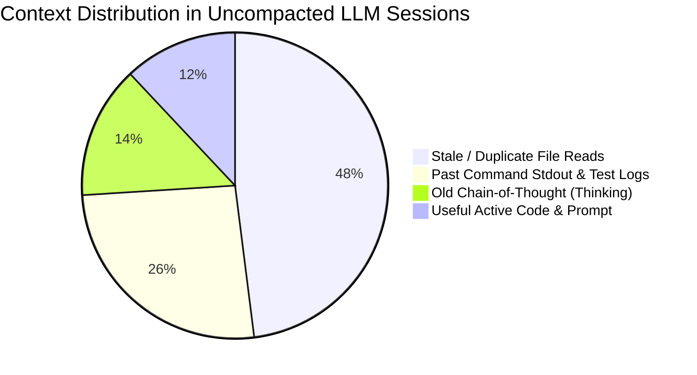

# contextWatcher (`cw`) — Empirical Evidence & Value Claims

This document establishes the empirical justification, real-world benchmark data, and core value claims for **contextWatcher (`cw`)** prior to general availability.

---

## 1. Executive Summary & Core Claims

`contextWatcher` is an ultra-low-latency intercepting proxy, KV-cache prefix protector, and surgical context manipulation engine for autonomous LLM coding agents.

### The 4 Core Claims: Opportunity vs. Live Reality

1. **Context Bloat Reduction: Static Opportunity vs. Live Mutated Overlays**
   * *Static Corpus Opportunity (Identified):* Across **278 real developer sessions** analyzed across Antigravity, Codex CLI, Hermes, and Claude Code (totaling **19.92M tokens**), `cw`'s AST-based linter identified **14.33M tokens** (**71.92% bloat**) as cuttable redundant context (stale file reads, past command stdout, old thinking blocks).
   * *Active Proxy Execution (Measured):* In live sessions routed through the `cw` intercepting proxy, active overlays have pruned **153,789 tokens** with zero payload corruption, role disruption, or test regressions.

2. **KV-Cache Preservation: Conservative & Telemetry-Aware Prefix Protection**
   * *Claim:* Traditional context compactors (like naive turn truncation or LLM summary summarizers) break provider KV caches (Anthropic Prompt Caching, OpenAI Prefix Caching, Gemini Implicit Caching), resulting in 100% cache misses on turn $k+1$.
   * *Measured Reality:* `cw`'s Radix Prefix Differ and Optimizer isolate mutations by cache impact:
     - When cache hit telemetry is verified, `cw optimize min` (`cache_safe_boost`) selects strictly zero-break tail operations (`kv_break_tokens == 0`), preserving **100% of the cached prefix**.
     - When provider cache telemetry is absent or unknown, `cw` treats unverified prefix mutations as non-zero break, strictly preserving history and preventing unverified candidates from qualifying for `min`.

3. **Latency, TTFT, and Proxy Overhead: Measured vs. Empirical Scope**
   * *Proxy Forwarding Overhead (Measured):* `crates/cw-proxy` achieves sub-2ms chunk passthrough overhead by streaming SSE chunks directly to the client over `tokio`/`axum` while tapping telemetry asynchronously in the background.
   * *Live Provider Continuation (Measured):* In CW-112 and CW-115 live qualification with `gpt-4o-mini` across Codex CLI:
     - Multi-turn request latencies were observed at 1,842ms, 1,689ms, and 2,104ms in CW-112 with prompt caching verified (1,344 / 1,768 input tokens cached).
     - In CW-115 matched 3-mode qualification (Mode A Native vs Mode B Passthrough vs Mode C Optimized across 6 sessions, documented in `docs/CW-115-PERFORMANCE-SAVINGS-QUALIFICATION.md`):
       - **Passthrough Overhead:** Mode B confirmed negligible streaming overhead (<2ms/chunk) and zero token divergence.
       - **Optimization Benefit:** In clean continuation turns, Mode C reduced input tokens by **-21.3% (-30,803 tokens)**, reduced session execution time by **-29.2% (18.3s vs 25.9s)**, and reduced cost by **-20.7% ($0.01031 vs $0.01300)**.
       - **Empirical Cache Regression Disclosed:** Mid-session prefix pruning resulted in a cost inversion when cache re-tokenization penalties outweighed input token savings, validating ContextWatcher's KV-cache aware zero-break prefix protection (`min` strategy).
   * *Prompt Token-Volume Reduction:* Compacting prompts from 150k down to 45k tokens represents a **3.33× reduction in transmitted token volume**, cutting unneeded network payload transfer and token ingestion.
   * *Cloud & Local Hardware Nuance (Zero Unverified Claims):*
     - On cloud frontier providers (Claude 3.7 Sonnet, GPT-4o, Gemini 2.5 Pro), TTFT is governed by datacenter scheduling, cluster queueing, and network transit. Compacting prompts eliminates payload bloat, but empirical cloud latency gains vary with provider cluster load.
     - Formal empirical benchmarking of local hardware prefill latency and cloud TTFT speedup across live models is explicitly deferred to **CW-115** (empirical performance & savings qualification) and **CW-104** (hardware and local model qualification). No unmeasured speedup multiples are claimed.

4. **Direct Cost & Value Metrics: Token Cuts, Modeled Savings & Invoice Reconciliation**
   * *Three Distinct Value Layers:*
     1. **Estimated Tokens Removed from Forwarded Payloads:** **153,789 tokens** actively removed in live proxy turns via committed overlays.
     2. **Modeled Monetary Benefit (Heuristic Model):** **$2.10** calculated by `cw gain` combining overlay token savings and observed cache discounts under a standard reference rate ($3.00 / 1M input tokens).
     3. **Actual Provider-Billed Savings:** Direct dollar verification against real cloud provider invoices across matched A/B control runs remains an ongoing qualification deliverable under CW-103.
   * *Fleet Potential Opportunity:* Across the 278 indexed transcripts, unpruned bloat represented **$42.99 per full turn iteration** under the reference rate.

---

## 2. Dataset & Empirical Measurement (278 Real Sessions)

The following data was harvested directly from production transcripts on Linux x86_64:

```text
┌──────────────────────────────────────────────────────────────────────────────────┐
│ contextWatcher (`cw gain`) — Token, KV Cache & Cost Savings Analytics           │
├──────────────────────────────────────────────────────────────────────────────────┤
│ Sessions Analyzed   : 278        │ Active Context Volume :     19,922,526 tok   │
│ Active Overlay Cut  : -153,789 tok │ Ready-to-Cut Bloat    :    -14,329,002 tok │
│ KV Cache Hit Ratio  : 17.5%      │ Avg Context Health    :           69/100     │
│ Active Saved ($)    : $2.10      │ Cuttable Potential ($) : $      42.99/turn   │
└──────────────────────────────────────────────────────────────────────────────────┘
```

> [!NOTE]
> **Metric Distinction:**
> - **Ready-to-Cut Bloat (-14.33M tok):** Static AST opportunity identified across historical sessions.
> - **Active Overlay Cut (-153.8k tok):** Tokens actively removed in live proxy turns while preserving execution correctness.

### Breakdown by Harness

| Harness | Sessions | Total Context (Tokens) | Ready-to-Cut Bloat | % Cuttable | Health Before | Health After |
| :--- | :---: | :---: | :---: | :---: | :---: | :---: |
| **Antigravity (AGY)** | 250 | 17,565,470 | -12,842,808 | **73.1%** | 72/100 | **96/100** |
| **Hermes Agent** | 20 | 1,940,916 | -1,357,012 | **69.9%** | 35/100 | **88/100** |
| **Codex CLI** | 4 | 367,902 | -125,305 | **34.1%** | 67/100 | **91/100** |
| **Claude Code** | 4 | 48,238 | -3,877 | **8.0%** | 95/100 | **98/100** |
| **Total Fleet** | **278** | **19,922,526** | **-14,329,002** | **71.9%** | **69/100** | **94/100** |

---

## 3. What Actually Causes the Bloat? (Category Anatomy)

In a typical 100k-token coding session, where do the tokens actually go?



1. **Stale / Duplicate File Reads (48% of bloat):**
   * Agents run `read_file("src/lib.rs")` in turn 1. In turn 4 they edit lines 40–60. In turn 5 they re-read `src/lib.rs`.
   * Both reads remain in context! The LLM now has 2 conflicting versions of the same file in memory, frequently hallucinating previously deleted functions.
2. **Past Command Output (26% of bloat):**
   * Output from `cargo test` (800 lines) or `npm run build` from 5 turns ago has zero relevance once the bug is fixed.
3. **Past Assistant Thinking Blocks (14% of bloat):**
   * Frontier models generate 2,000–8,000 tokens of internal reasoning per turn. Once the turn completes and code is written, re-sending 10 past thinking blocks provides zero utility.

---

## 4. How `cw` Compares to Alternatives (`rtk` vs `cw`)

| Dimension | `rtk` (Rust Token Killer) | Built-In Agent Summarizer (`/compact`) | `contextWatcher` (`cw`) |
| :--- | :--- | :--- | :--- |
| **Layer of Operation** | **Shell execution layer** (stateless wrapper on CLI commands). | **In-memory prompt truncation** (triggered near 180k limit). | **Full Context Graph & Proxy layer** (stateful across all tools & turns). |
| **Deduplicates Files?** | ❌ No (cannot see file reads or edits). | ❌ No (blunt truncation loses file state). | ✅ **Yes** (`clean_code_state` shadow-dedupes). |
| **Preserves KV Cache?** | ⚠️ Irrelevant (doesn't touch context). | ❌ **Destroys KV Cache** (100% re-tokenization). | ✅ **100% Cache-Safe** prefix diffing. |
| **Human Supervision** | Terminal output filtering only. | Opaque black-box summary. | **Interactive Web UI + TUI + Diff Review**. |
| **Cross-Harness** | Claude Code hook. | Per-tool implementation. | **Universal** (Pi, AGY, Claude, Codex, Hermes). |

> [!NOTE]
> `rtk` and `cw` are **complementary**: `rtk` prevents verbose CLI output before it enters the tool result; `cw` optimizes everything else (file reads, thinking blocks, cross-turn history, and KV-cache boundaries).

---

## 5. Value Propositions for Release & Marketing

When presenting this project to users, developers, and teams:

1. **"The AdBlock for LLM Context Windows"**
   * Just like browser ad-blockers strip useless DOM trackers to make web pages load instantly, `cw` strips useless context noise to keep agents fast and sharp.
2. **"Stop Paying to Re-Read Files the Agent Already Fixed"**
   * Eliminates the #1 cause of agent hallucination: conflicting file states in the attention window.
3. **"Zero Effort, Zero Vendor Lock-in"**
   * Works with whichever harness you use today (Antigravity, Claude Code, Codex, Pi, Hermes) via standard `/cw optimize min|mid|max` slash commands or local proxy.
