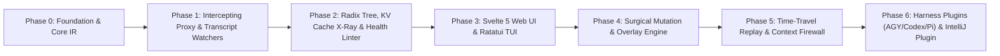

# ROADMAP.md — `contextWatcher` Product & Engineering Roadmap

This roadmap structures the development of `contextWatcher` (`cw`) so that **every phase delivers a working, immediately useful tool**, building progressively from passive X-Ray inspection to full active context manipulation and multi-surface IDE/harness integration.

---

## High-Level Milestone Flow

---

## Phase 0: Workspace Foundation & Canonical Context IR
**Goal:** Establish the Rust Cargo workspace, SQLite storage layer, and the lossless Canonical Context Intermediate Representation (IR).

* **Deliverables:**
  * Cargo workspace (`cw-core`, `cw-proxy`, `cw-store`, `cw-harnesses`, `cw-mcp`, `cw-tui`, `cw-cli`).
  * Canonical Context Graph data structures (`Session`, `ContextTurn`, `ContextNode`, `NodeKind`, `NodeFingerprint`).
  * Lossless raw JSON envelope mapping (so we can parse Anthropic Messages, OpenAI Chat/Responses, and Gemini GenerateContent payloads and reconstruct them without losing unknown fields or signatures).
  * Tokenization engine (`tiktoken-rs` + heuristic/exact token counters per provider).
  * SQLite schema for sessions, turns, nodes, KV metrics, and mutation overlays.

---

## Phase 1: Multi-Provider Intercepting Proxy & Transcript Adapters
**Goal:** Capture 100% of live LLM harness traffic AND existing local disk sessions with zero friction.

* **Deliverables:**
  * **HTTP/SSE Proxy (`cw-proxy`):**
    * Endpoints for `/anthropic/v1/messages`, `/openai/v1/chat/completions`, `/openai/v1/responses`, and `/gemini/v1beta/*`.
    * Full SSE streaming support with $<2\text{ms}$ latency overhead, capturing thinking blocks, tool calls, and token usage/cache telemetry.
  * **Disk Transcript Watchers (`cw-harnesses`):**
    * **Antigravity (AGY):** Real-time file watcher (`notify`) for `<appDataDir>/brain/<conversation-id>/.system_generated/logs/transcript.jsonl` & `transcript_full.jsonl`.
    * **Codex CLI:** Session log & rollout parser.
    * **Pi / OpenCode / Aider:** Session history and chat log adapters.
    * **Claude Code:** `~/.claude/projects/**/*.jsonl` watcher.
  * **CLI Wrapper (`cw wrap <cmd>`):**
    * Run `cw wrap agy`, `cw wrap codex`, or `cw wrap pi` to automatically inject proxy environment variables (`OPENAI_BASE_URL`, `ANTHROPIC_BASE_URL`, etc.) and attach to the session.

---

## Phase 2: Radix Tree, KV Cache X-Ray & Context Health Linter
**Goal:** Turn raw turns into a structural graph, reconstruct KV cache state, and automatically diagnose context rot.

* **Deliverables:**
  * **Radix Prefix Tree Builder:**
    * Aligns token prefixes across consecutive turns ($T_{n-1} \to T_n$) and across conversation forks.
  * **KV Cache Boundary Analyzer:**
    * Classifies every node and token range into:
      * `CachedHit` (Green)
      * `NewlyCached` (Yellow)
      * `CacheInvalidated` (Red — with exact diff showing *which* mutated block/tool/timestamp broke the prefix).
    * Visualizes explicit `cache_control` breakpoints and warns when misplaced.
  * **Context Health & Linting Engine:**
    * **Stale File Detector:** Cross-references `read_file` nodes against later `edit_file`/`write_file` tool calls and live filesystem `mtime`/hash.
    * **Duplicate Detector:** Finds repeated file reads and identical bash outputs.
    * **Tool Bloat Analyzer:** Calculates token percentage consumed by unused MCP tool schemas and skills.
    * **Attention Dilution ("Lost in the Middle") Estimator:** Scores critical instructions and pinned rules by position weight.

---

## Phase 3: Web UI Dashboard (Svelte 5) & Terminal UI (Ratatui)
**Goal:** Give developers real-time visual X-Ray into their harness context from browser or terminal.

* **Deliverables:**
  * **Svelte 5 + XYFlow + D3 Web UI (`web/`):**
    * **Context Graph / Radix Tree View:** Interactive node-and-edge graph of System Prompts, Rules, Skills, MCP Schemas, Turns, Tool Calls, and Branches, color-coded by KV Cache status and lint warnings.
    * **Token Treemap & Flamegraph:** Proportional breakdown of the context window (e.g., "MCP Tools: 24%, File Reads: 41%, Bash Logs: 19%").
    * **Node Inspector & Diff Drawer:** Side-by-side raw JSON vs. rendered markdown, token counts, and cache invalidation diffs.
  * **Ratatui TUI (`cw tui`) & CLI (`cw status`, `cw inspect`):**
    * Instant keyboard-driven terminal dashboard for developers working in tmux/SSH.

---

## Phase 4: Surgical Mutation & Deterministic Overlay Engine
**Goal:** Allow developers (and agents) to actively edit, prune, fold, deduplicate, pin, and gate context to improve model quality and speed.

* **Deliverables:**
  * **Deterministic Mutation Ledger (`cw-core::mutation`):**
    * Fingerprints incoming messages (`NodeFingerprint`) and applies active mutations as an overlay on every subsequent proxy request.
    * Bi-directional transcript sync option for harnesses that support disk reload.
  * **Core Context Operations:**
    1. **Prune / Stub Node:** Replace a massive tool output with a compact stub.
    2. **Subtree Folding:** Collapse a multi-turn failed debugging branch into a concise summary node (manual or LLM-assisted).
    3. **Shadow Deduplication:** One-click (or automatic rule) replacement of older duplicate/stale `read_file` nodes with `[Superseded by Turn #N]`.
    4. **Dynamic Tool & Rule Gating:** Live checkboxes to strip disabled MCP tool definitions or skills from outgoing requests.
    5. **Context Pinning (Attention Boosting):** Inject `<pinned_context>` reminders at the high-attention tail of the prompt without breaking the prefix KV cache.
    6. **Cache-Safe Batch Mode:** Stage mutations in a "Draft Queue" and commit them only when ready (or when the cache threshold triggers) so you don't break the KV cache on every single turn.

---

## Phase 5: Context Firewall (Breakpoints) & Time-Travel A/B Replay
**Goal:** Prevent context poisoning *before* it reaches the model, and scientifically evaluate context changes via branching.

* **Deliverables:**
  * **Context Firewall (Interactive Breakpoints):**
    * Configurable rules (e.g., `tool_output.tokens > 4000`, `cache_invalidated == true`, or manual pause).
    * Holds the HTTP proxy request open, alerts the user in Web UI / TUI / IntelliJ, allows live editing/truncation, and resumes forwarding.
  * **Time-Travel Forking & A/B Replay Studio:**
    * Select any historical turn $\rightarrow$ Fork $\rightarrow$ Apply mutations (e.g., fold turns 4–8, disable 15 tools) $\rightarrow$ Replay request to provider $\rightarrow$ Compare output quality, latency, and token cost side-by-side.

---

## Phase 6: Harness Plugins (AGY, Codex, Pi) & IntelliJ IDE Plugin
**Goal:** Bring `contextWatcher` directly inside the agent's own toolbelt and into the developer's code editor.

* **Deliverables:**
  * **Built-in MCP Server (`cw mcp`):**
    * Exposes tools (`cw_context_status`, `cw_fold_turns`, `cw_prune_output`, `cw_pin_fact`, `cw_evict_stale_files`) so the agent itself can self-clean its context!
  * **Harness Native Plugins (`plugins/`):**
    * **Antigravity (AGY):** Native skill (`skills/context-watcher/SKILL.md`) + MCP registration + transcript sync.
    * **Codex CLI & Pi / OpenCode / Claude Code:** Wrapper scripts, hooks, and `/cw` slash commands.
  * **IntelliJ Platform Plugin (`ide/cw-intellij`):**
    * **Editor Gutter & Tab Badges:** Shows whether the currently open file is in the LLM's context (`Fresh 🟢`, `Stale 🟠 - modified 2x since Turn 6`, or `Not in Context ⚪`).
    * **IDE Tool Window:** Embedded Context Tree, KV Cache meter, Firewall alerts, and 1-click "Evict Stale Read" / "Pin Selection to Context" editor actions.
