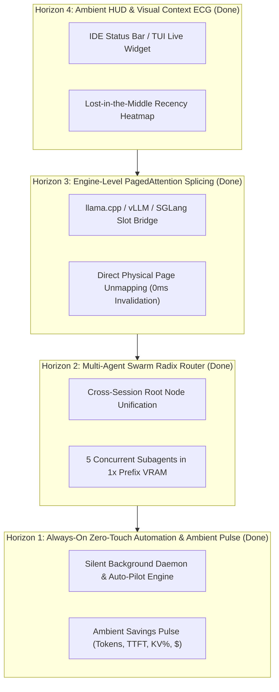

# ROADMAP.md — `contextWatcher` Product & Engineering Roadmap

> **Core Philosophy:** *"The best tool is the one you don't have to call or see. It is always on, does everything automatically, and only drops a message every now and then: 'We saved you 12,966 tokens, KV Cache 98.2% preserved, TTFT: 176s -> 1.6s (108x faster)'."*

---

## 🗺️ Architectural Stack: The 4 Evolutionary Horizons

The future horizons of `contextWatcher` form a **layered, mutually reinforcing stack**:

---

## 📍 Horizon 1: Always-On Zero-Touch Automation & Ambient Pulse *(Done)*

**Goal:** Turn `contextWatcher` into an invisible, autonomous memory guardian. The developer never runs `/cw optimize` or remembers slash commands. `cw` silently intercepts agent traffic, prunes dead monologues and command bloat, and drops a periodic ambient notification:

> `⚡ [cw] We saved you 12,966 tokens | KV Cache: 98.2% preserved | TTFT: 176s -> 1.6s (108x faster) | $0.18 saved`

### Delivered Capabilities:
1. **Always-On Transparent Daemon:** Runs as a lightweight local service (`cw daemon` / `cw serve`) with zero CPU overhead when idle.
2. **Autonomous Proactive Health Guardian:**
   - Detects runaway monologue blocks (>10k thinking tokens).
   - Detects stale duplicate file reads (>2 copies of the same file).
   - Detects massive terminal command stdout (>100 tokens at tail).
   - Autonomously commits optimal non-breaking overlays without interrupting the user.
3. **Ambient Savings Reporter:**
   - Calculates exact cumulative tokens saved, KV cache hit ratio, Time-to-First-Token acceleration, and dollar savings.
   - Drops periodic, non-intrusive progress updates via terminal banner, desktop notification, or harness post-tool output.
4. **Zero-Config Universal Wrappers:**
   - Automatically wraps `claude`, `omp`, `codex`, and `agy` commands with proxy variables.

---

## 📍 Horizon 2: Multi-Agent Swarm Radix Router *(Done)*

**Goal:** Coordinate swarms of multiple AI agents (e.g. Lead Architect + 4 Subagents) so they share a single system prompt and repository context in GPU memory.

### Delivered Capabilities:
1. **Cross-Agent Prefix Unification:**
   - Detects common system rules, repository maps, and skill definitions across different agent threads (`analyze_swarm_prefix_sharing`).
   - Standardizes the root nodes of their Radix trees to match byte-for-byte.
2. **1x VRAM Memory Multiplexing:**
   - On local engines (`llama.cpp` / vLLM), the shared system prefix is cached once in VRAM.
   - Multiple subagents branch off as lightweight leaf nodes, allowing multi-agent swarms to run on consumer GPUs without out-of-memory crashes.
3. **CLI & API Inspection:**
   - `cw swarm [--project <name>] [--model <name>] [--min-members <N>] [--json]` to inspect active swarms, shared tokens, and VRAM saved.
   - REST API endpoints `/api/v1/swarms` and `/api/v1/swarms/:group_id/graph`.

---

## 📍 Horizon 3: Hardware & Inference Engine Splicing (PagedAttention Splicing) *(Done)*

**Goal:** Enable local inference engines to drop prefix tokens with **literal 0ms prefill re-computation**.

### Delivered Capabilities:
1. **Engine Slot Bridge & PagedAttention Block Mapper:**
   - [`slot_bridge.rs`](file:///home/gionag/Development/contextWatcher/crates/cw-core/src/slot_bridge.rs) models PagedAttention block mapping (16 or 64 tokens per page) and deterministic slot affinity.
2. **Physical Page Unmapping & Splicing Calculations:**
   - [`plan_slot_splicing`](file:///home/gionag/Development/contextWatcher/crates/cw-core/src/slot_bridge.rs) calculates exact physical pages freed, boundary alignment padding, and avoided prefill latency when pruning intermediate nodes.
3. **CLI & REST API Integration:**
   - `cw slot` CLI command for live engine slot inspection and splicing simulation.
   - REST endpoints `/api/v1/engine/slots` and `/api/v1/engine/slots/:slot_id/splice`.

---

## 📍 Horizon 4: Ambient HUD & Visual Context ECG *(Done)*

**Goal:** Provide tactile, real-time observability into what an AI agent is reading.

### Delivered Capabilities:
1. **IDE & Terminal Statusline Widget:**
   - Ultra-fast (`<1ms`) status-bar indicator via `cw hud`: `🟢 28k [98% KV] (-13k) H:89`.
   - Native integration with Starship prompt, tmux, zellij, and IDE status bars.
2. **Lost-in-the-Middle Attention Heatmap & ECG:**
   - Empirical U-curve attention salience calculation (`evaluate_attention_ecg`) across Primacy (0-20%), Attention Trough (20-80%), and Recency (80-100%).
   - Automatic risk flagging when critical system rules or tool schemas sink into the middle 40-60% dead zone.
3. **REST API & CLI:**
   - `cw hud [--compact] [--ecg] [--json]` CLI command.
   - REST endpoints `/api/v1/hud`, `/api/v1/sessions/:id/hud`, and `/api/v1/sessions/:id/ecg`.

---

## 🟢 Completed Milestones (v0.1 Foundation)

* **Phase 0: Workspace Foundation & Canonical Context IR** — Complete IR normalization, BLAKE3 fingerprinting, SQLite storage.
* **Phase 1: Multi-Provider Intercepting Proxy & Watchers** — Axum SSE streaming tap for Anthropic, OpenAI, Gemini; watchers for AGY, Codex, OMP, Claude.
* **Phase 2: Radix Tree, KV Cache X-Ray & Context Linter** — Radix graph, KV boundary differ, stale file & loop linters.
* **Phase 3: Svelte 5 Web UI & Ratatui TUI** — Real-time Web UI graph, Flamegraph, TUI dashboard.
* **Phase 4: Surgical Mutation & Deterministic Overlay Engine** — `ShadowDedupe`, `PruneOrStub`, `FoldSubtree`, `GateToolsAndSkills`, `PinContext`.
* **Phase 5: Time-Travel Replay & Context Firewall** — Breakpoints, A/B replay, fail-open validation gate.
* **Phase 6: Multi-Harness Plugins & MCP Integration** — Antigravity skill, Codex wrapper, Pi/Claude hooks, built-in MCP server.
* **Phase 7: Empirical Hardware Benchmarks** — 8k-128k context scaling and ROCm dual AMD Radeon Instinct gfx906 multi-turn proofs.
