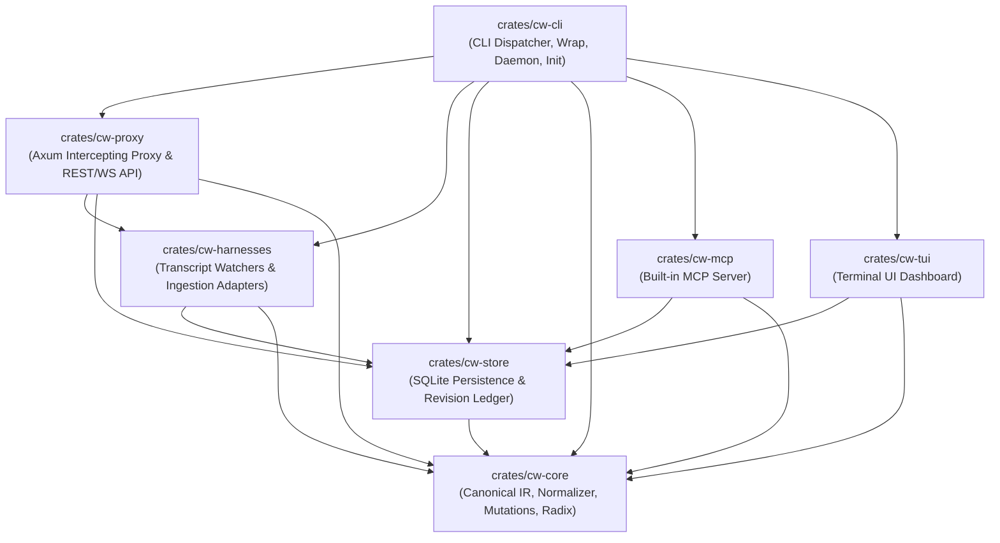
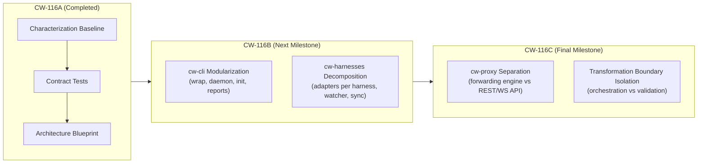

# CW-116 Architecture & Modularization Plan

**Document:** Architecture Map, Dependency Boundaries & Refactoring Blueprint  
**Campaign:** CW-116 Maintainability Gate (CW-116A -> CW-116B -> CW-116C)  
**Status:** Baseline established in CW-116A; handoff for CW-116B and CW-116C  
**Author:** AI Agent pair programming with repository maintainer  

---

## 1. Current System Topology & Dependency Graph



### 1.1 Crate Responsibilities Summary

| Crate | Responsibility | Key Public Entry Points | Primary Dependencies |
|---|---|---|---|
| **`cw-core`** | Domain models (`ContextTurn`, `ContextNode`), Canonical AST IR parsing, token estimation, Radix tree diffing, mutation operators, invariant validation, and control token generation | `parse_request_to_nodes`, `apply_mutations_to_payload`, `validate_protocol_invariants`, `control::control_token` | `blake3`, `serde_json`, `uuid`, `chrono`, `regex` |
| **`cw-store`** | Embedded SQLite database (`cw.db`), session/turn records, content-addressed blob storage, revision checks, mutation rules, wire requests | `CwStore::open`, `CwStore::open_in_memory`, `save_turn`, `save_mutation`, `save_wire_request`, `get_wire_request` | `cw-core`, `rusqlite` |
| **`cw-proxy`** | Local loopback HTTP intercepting proxy (port 4401) and REST/WebSocket API (port 4400), pre-forward mutation injection, validation gating, credential stripping, SSE streaming accumulator | `build_proxy_router`, `build_api_router`, `SseChunkAccumulator`, `extract_cached_tokens_from_sse` | `cw-core`, `cw-store`, `cw-harnesses`, `axum`, `tokio`, `tower` |
| **`cw-harnesses`** | Ingestion of on-disk agent transcripts (JSONL & SQLite), background directory watcher, disk sync-back with `.bak` safety, auto-healing trigger, qualification config helpers | `import_generic_jsonl_transcript`, `import_agy_transcript`, `import_hermes_state_db`, `spawn_transcript_watcher`, `sync_mutations_to_transcript_on_disk` | `cw-core`, `cw-store`, `notify`, `rusqlite` |
| **`cw-mcp`** | Built-in Model Context Protocol stdio server allowing agent models to inspect and compact their own context via standard MCP tool calls | `run_mcp_stdio_server` | `cw-core`, `cw-store`, `reqwest` |
| **`cw-tui`** | Terminal dashboard for real-time visualization of turns, token salience, KV-cache prefix hits, and mutation status | `run_tui` | `cw-core`, `cw-store`, `ratatui`, `crossterm` |
| **`cw-cli`** | Binary entry point (`cw`), Clap argument parsing, monolithic command execution (`match cli.command`), subprocess launcher (`cw wrap`), plugin installer (`cw init`), daemon process manager (`cw daemon`) | `main()` | All workspace crates, `clap`, `rust-embed` |

---

## 2. Core Architectural Contracts & Invariants

During any refactoring in CW-116B and CW-116C, the following six invariants must be preserved:

### Invariant 1: Zero-Drop Wire Transparency & Provider-Specific Field Preservation
In passthrough mode or when no mutations apply, the proxy must never alter or drop provider-specific fields (e.g., `model`, `temperature`, `response_format`), reasoning blocks, Anthropic `signature` in thinking events, or Gemini `thoughtSignature`. Raw byte fidelity is verified by [`test_core_contract_ac5_signed_request_byte_for_byte_fidelity`](file:///home/gionag/Development/contextWatcher/crates/cw-proxy/tests/qualification.rs#L700-L755) and [`contract_proxy_routing_and_fallback_provider_selection`](file:///home/gionag/Development/contextWatcher/crates/cw-proxy/tests/characterization_contracts.rs#L250-L325).

### Invariant 2: Strict Credential Stripping & Tool Sandboxing
- Internal headers (`x-cw-session-id`, `x-cw-control-token`, `x-cw-workspace`, `x-cw-dry-run`) are stripped before any request reaches upstream model endpoints.
- Non-Codex harnesses wrapped via `cw wrap` have `CW_CONTROL_TOKEN` and `CW_CONTROL_TOKEN_FILE` removed from their environment, preventing untrusted model-invoked shell commands from accessing the local control daemon.
- Codex CLI excludes `CW_CONTROL_TOKEN` from subshells via native configuration (`shell_environment_policy.filters.CW_CONTROL_TOKEN="exclude"`).
- Hermes uses temporary UUID-scoped handoff files (`hermes-override-<uuid>.json`) created with mode `0600` and unlinked atomically upon first consumption.

### Invariant 3: Pristine Source Transcripts & Immutability
On-disk session transcripts (`.jsonl`) and state databases (`hermes.db`, `opencode.db`) are treated as immutable source-of-truth records. In-memory proxy overlays and Context Transform responses never overwrite the harness's disk transcript in-place. Verified by [`test_core_contract_ac7_original_transcripts_untouched_bit_for_bit`](file:///home/gionag/Development/contextWatcher/crates/cw-proxy/tests/qualification.rs#L850-L910).

### Invariant 4: Pre-Forward Validation Gate & Fail-Open Recovery
If an active mutation (pruning, folding, or deduplication) invalidates protocol invariants (e.g., produces an orphan tool call ID or orphan tool result ID), the Pre-Forward Validation Gate catches the violation, emits a diagnostic warning, and automatically fails open by forwarding the unmutated original raw payload. Verified by [`test_core_contract_ac8_safe_recovery_and_validation_gate_fail_open`](file:///home/gionag/Development/contextWatcher/crates/cw-proxy/tests/qualification.rs#L920-L990) and [`contract_transform_context_api_auth_validation_and_fail_open`](file:///home/gionag/Development/contextWatcher/crates/cw-proxy/tests/characterization_contracts.rs#L60-L245).

### Invariant 5: Protected User and System Prompts
User prompts and system prompts are strictly immune from pointer-based or automated pruning and stubbing. Only completed, eligible tool outputs and thinking blocks can be compacted. Verified by [`user_and_system_prompts_are_never_pruned_or_stubbed_by_pointer`](file:///home/gionag/Development/contextWatcher/crates/cw-core/tests/safety_test.rs#L425-L485).

### Invariant 6: Content-Addressed Blob Storage & Revision Integrity
Raw payloads are deduplicated using BLAKE3 hashes in SQLite blob storage. Mutation state updates are revision-checked to prevent race conditions or overwriting concurrent turn updates. Verified by [`wire_requests_are_immutable_and_blob_storage_is_content_addressed`](file:///home/gionag/Development/contextWatcher/crates/cw-store/tests/safety.rs#L250-L285).

---

## 3. Coupling Hotspots & Structural Problems

### Hotspot 1: Monolithic CLI Entry Point (`crates/cw-cli/src/main.rs`)
- **Current Size:** 3,216 lines.
- **Problem:** A single `main()` function handles command-line parsing, subprocess launching (`Commands::Wrap`), environment sanitization, daemon detached starting (`fork`), plugin installation (`Commands::Init`), systemd unit generation, embedded web UI serving via `rust-embed`, gain calculation, swarm analysis, slot bridge reporting, and HUD status generation.
- **Consequence:** Modifying harness launch logic (e.g. for Codex or Hermes) risks inadvertently breaking daemon lifecycle, update checks, or report formatting.

### Hotspot 2: Monolithic Harness Integration (`crates/cw-harnesses/src/lib.rs`)
- **Current Size:** 2,385 lines.
- **Problem:** Antigravity JSONL, Codex rollout JSONL, OMP JSONL, Claude Code JSONL, Hermes SQLite, and OpenCode SQLite parsing routines reside in one flat file alongside filesystem watchers (`notify`), background auto-healing loops, disk sync-back, and qualification configuration helpers.
- **Consequence:** Adding or hardening one harness adapter requires modifying a multi-thousand-line file with shared internal helpers.

### Hotspot 3: Entangled Reverse Proxy & API Router (`crates/cw-proxy/src/lib.rs` & `forwarding.rs`)
- **Current Size:** 1,974 lines (`lib.rs`) + 585 lines (`forwarding.rs`).
- **Problem:** Reverse proxy request routing, fallback detection, upstream forwarding, SSE chunk parsing, context transformation endpoint (`/api/v1/sessions/:id/transform`), REST CRUD handlers for mutations/turns, and WebSocket hub are combined in `cw-proxy/src/lib.rs`.
- **Consequence:** Changes to proxy wire forwarding risk regressing the REST API, and vice versa.

---

## 4. Recommended Decomposition Plan

The refactoring will proceed across two discrete, behavior-preserving phases (CW-116B and CW-116C).



---

### 4.1 Phase 1: CW-116B — CLI & Harness Lifecycle Modularization

**Target:** Split `cw-cli/src/main.rs` and `cw-harnesses/src/lib.rs` into focused, cohesive modules without changing any public CLI flags, environment variables, or runtime behavior.

#### 1. `cw-cli` Module Structure
```
crates/cw-cli/src/
├── main.rs                  # Clean entry point: clap parse + dispatch (~150 lines)
├── commands/
│   ├── mod.rs               # Command router
│   ├── wrap.rs              # Harness launcher, env sanitization, OverrideFileCleanup (~350 lines)
│   ├── daemon.rs            # start_daemon_detached, stop, restart, status (~150 lines)
│   ├── init.rs              # run_init_installer, plugin templates (~400 lines)
│   ├── reports.rs           # run_gain_report, run_hud_report, run_swarm_report (~450 lines)
│   ├── slot.rs              # run_slot_bridge_report (~200 lines)
│   └── web.rs               # serve_embedded_web_ui (~50 lines)
└── update.rs                # Existing self-update implementation (367 lines, unchanged)
```

#### 2. `cw-harnesses` Module Structure
```
crates/cw-harnesses/src/
├── lib.rs                   # Re-exports and public facade (~100 lines)
├── error.rs                 # HarnessError enum (~40 lines)
├── sync.rs                  # sync_mutations_to_transcript_on_disk (~180 lines)
├── watcher.rs               # spawn_transcript_watcher & scanner (~150 lines)
├── auto_heal.rs             # check_and_apply_auto_heal (~120 lines)
├── qualification.rs         # codex_proxy_config_args, omp_proxy_models_config (~80 lines)
└── adapters/
    ├── mod.rs               # Adapter dispatch
    ├── agy.rs               # import_agy_transcript (~350 lines)
    ├── codex.rs             # Codex rollout JSONL parser (~250 lines)
    ├── omp.rs               # OMP / Pi JSONL parser (~200 lines)
    ├── claude.rs            # Claude Code JSONL parser (~200 lines)
    ├── hermes.rs            # import_hermes_state_db SQLite parser (~300 lines)
    └── opencode.rs          # import_opencode_state_db SQLite parser (~250 lines)
```

#### Protective Contracts for CW-116B
- [`wrap_tests::codex_wrapper_uses_proxy_provider_and_environment_backed_headers`](file:///home/gionag/Development/contextWatcher/crates/cw-cli/src/main.rs#L3064-L3073)
- [`wrap_tests::wrapper_removes_cw_credentials_from_harness_environment`](file:///home/gionag/Development/contextWatcher/crates/cw-cli/src/main.rs#L3046-L3060)
- [`wrap_tests::regression_test_override_file_cleanup_on_normal_exit_without_consumption`](file:///home/gionag/Development/contextWatcher/crates/cw-cli/src/main.rs#L3076-L3095)
- [`wrap_tests::regression_test_override_file_cleanup_on_write_failure`](file:///home/gionag/Development/contextWatcher/crates/cw-cli/src/main.rs#L3098-L3123)
- [`wrap_tests::init_dry_run_leaves_filesystem_and_systemd_untouched`](file:///home/gionag/Development/contextWatcher/crates/cw-cli/src/main.rs#L3148-L3153)
- [`wrap_tests::session_id_validation_contract`](file:///home/gionag/Development/contextWatcher/crates/cw-cli/src/main.rs#L3184-L3199)
- [`wrap_tests::header_stripping_preserves_complex_non_cw_headers`](file:///home/gionag/Development/contextWatcher/crates/cw-cli/src/main.rs#L3155-L3171)
- [`test_harness_binary_codex_cli_multiturn_overlay_reapplication`](file:///home/gionag/Development/contextWatcher/crates/cw-proxy/tests/qualification.rs#L1200-L1300)
- [`test_harness_binary_omp_native_runtime_overlay_reapplication`](file:///home/gionag/Development/contextWatcher/crates/cw-proxy/tests/qualification.rs#L1310-L1400)
- [`test_harness_binary_hermes_middleware_session_binding`](file:///home/gionag/Development/contextWatcher/crates/cw-proxy/tests/qualification.rs#L1410-L1580)
- `python3 plugins/hermes/context-watcher/test_plugin.py`

---

### 4.2 Phase 2: CW-116C — Proxy & Transformation Boundaries

**Target:** Split `cw-proxy/src/lib.rs` into isolated proxy wire forwarding vs control REST/WS API boundaries.

#### 1. `cw-proxy` Module Structure
```
crates/cw-proxy/src/
├── lib.rs                   # Public exports: DaemonState, router builders (~120 lines)
├── state.rs                 # DaemonState definition, loopback guards, CORS (~150 lines)
├── sse.rs                   # SseChunkAccumulator, token extractors (~120 lines)
├── proxy/
│   ├── mod.rs               # build_proxy_router & routing dispatch (~150 lines)
│   ├── forwarding.rs        # Upstream HTTP client, header stripping, body forwarder (~350 lines)
│   ├── recorder.rs          # Turn and wire request recording (~150 lines)
│   └── preview.rs           # Dry-run preview handler (~100 lines)
└── api/
    ├── mod.rs               # build_api_router & control_guard auth (~150 lines)
    ├── transform.rs         # api_transform_context & Pre-Forward Validation Gate (~120 lines)
    ├── sessions.rs          # Session and turn REST endpoints (~200 lines)
    ├── mutations.rs         # Mutation CRUD and commit-drafts (~180 lines)
    ├── firewall.rs          # Intercept resolution and firewall rules (~150 lines)
    ├── hud.rs               # Attention HUD & ECG endpoints (~120 lines)
    ├── slot.rs              # Slot bridge and splice endpoints (~100 lines)
    └── ws.rs                # WebSocket event broadcast hub (~150 lines)
```

#### Protective Contracts for CW-116C
- [`contract_transform_context_api_auth_validation_and_fail_open`](file:///home/gionag/Development/contextWatcher/crates/cw-proxy/tests/characterization_contracts.rs#L40-L245)
- [`contract_proxy_routing_and_fallback_provider_selection`](file:///home/gionag/Development/contextWatcher/crates/cw-proxy/tests/characterization_contracts.rs#L250-L325)
- [`contract_proxy_strips_internal_cw_headers_before_forwarding`](file:///home/gionag/Development/contextWatcher/crates/cw-proxy/tests/characterization_contracts.rs#L330-L390)
- [`contract_proxy_dry_run_preview_never_calls_upstream`](file:///home/gionag/Development/contextWatcher/crates/cw-proxy/tests/characterization_contracts.rs#L395-L440)
- [`contract_unauthenticated_request_generates_synthetic_session`](file:///home/gionag/Development/contextWatcher/crates/cw-proxy/tests/characterization_contracts.rs#L445-L485)
- [`contract_sse_streaming_chunk_accumulator_and_cached_tokens`](file:///home/gionag/Development/contextWatcher/crates/cw-proxy/tests/characterization_contracts.rs#L490-L525)
- [`test_core_contract_ac1_session_identity_and_binding`](file:///home/gionag/Development/contextWatcher/crates/cw-proxy/tests/qualification.rs#L368-L442)
- [`test_core_contract_ac2_committed_overlay_on_next_model_request`](file:///home/gionag/Development/contextWatcher/crates/cw-proxy/tests/qualification.rs#L445-L520)
- [`test_core_contract_ac4_tool_call_result_pairing_preserved_under_active_mutation`](file:///home/gionag/Development/contextWatcher/crates/cw-proxy/tests/qualification.rs#L600-L690)
- [`test_core_contract_ac8_safe_recovery_and_validation_gate_fail_open`](file:///home/gionag/Development/contextWatcher/crates/cw-proxy/tests/qualification.rs#L920-L990)

---

## 5. Verification Gate for Future PRs

Before any PR for CW-116B or CW-116C can be merged, it must pass the exact baseline suite established in CW-116A:

```bash
# 1. Format and Linter Gates
cargo fmt --all -- --check
cargo clippy --workspace --all-targets -- -D warnings

# 2. Automated Workspace Tests (Must pass all 94+ tests)
cargo test --workspace

# 3. Python Concurrency Stress Tests
python3 plugins/hermes/context-watcher/test_plugin.py

# 4. Harness Binary Qualification (Must pass all 3 installed harnesses)
cargo test -p cw-proxy --test qualification harness_binary -- --ignored
```
