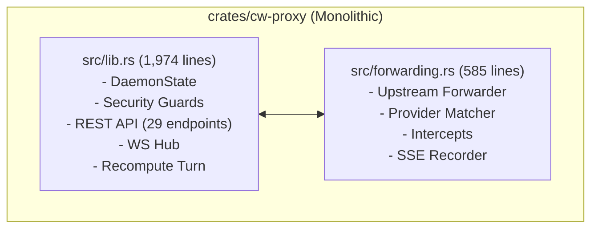
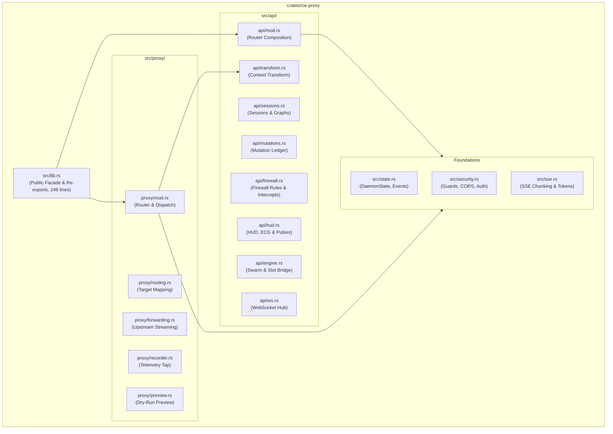
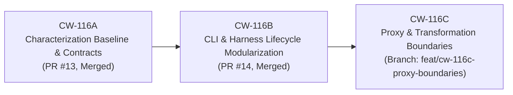

# CW-116C Refactoring Report: Proxy & Transformation Boundary Consolidation

- **Baseline Commit:** `b60c7d1b9fa6ea4cd1d5a182e0e5407dd57c26b1` on `main` (post-CW-116B merge, PR #14)
- **Branch:** `feat/cw-116c-proxy-boundaries`
- **Milestone:** CW-116 (Maintainability Gate, Final Milestone)
- **Scope:** Decompose monolithic `crates/cw-proxy` (`lib.rs` and `forwarding.rs`) into cohesive, single-responsibility modules separating provider request forwarding, telemetry, authentication, DNS-rebinding security, and REST/WebSocket control operations while preserving 100% observable behavior, wire-byte transparency, and fail-open guarantees.

---

## 1. Executive Summary & Objective

In ContextWatcher, `crates/cw-proxy` implements both the high-throughput, low-latency HTTP/SSE intercepting proxy (`127.0.0.1:4401`) and the daemon control REST/WebSocket API (`127.0.0.1:4400`). Prior to CW-116C, this crate was organized into two large, heavily coupled files:
- `crates/cw-proxy/src/lib.rs`: 1,974 lines (mixing `DaemonState`, DNS-rebinding/origin guards, authentication middleware, WebSocket hub, and 29 distinct REST endpoints for sessions, mutations, graphs, HUD, slots, and firewall rules).
- `crates/cw-proxy/src/forwarding.rs`: 585 lines (mixing upstream provider route resolution, header sanitization, session binding, autopilot evaluation, human-approval firewall intercepts, dry-run preview, streaming telemetry, and SQLite mutation recording).

Under CW-116C, `crates/cw-proxy` was decomposed into modular components with explicit dependency flow and isolated boundaries:
1. **Shared State & Security Foundations:**
   - `src/state.rs`: Core daemon state, intercept channels, and WebSocket event types.
   - `src/security.rs`: DNS-rebinding loopback host checks, origin validation, local CORS layer, and token-based control guard.
   - `src/sse.rs`: Streaming Server-Sent Events (SSE) reassembly and provider cache token extractors.
2. **Proxy Forwarding Engine (`src/proxy/`):**
   - `proxy/mod.rs`: `build_proxy_router` and request dispatch (`handle_proxy_request`).
   - `proxy/routing.rs`: Upstream provider detection, route mapping, and fallback path resolution.
   - `proxy/forwarding.rs`: Upstream HTTP client streaming, hop-by-hop header stripping, and internal `x-cw-*` removal.
   - `proxy/recorder.rs`: Asynchronous chunk tapping, first-body-byte latency, KV cache hit calculation, and drop cleanup.
   - `proxy/preview.rs`: Dry-run validation and mutation preview serialization.
3. **Control REST & WebSocket API (`src/api/`):**
   - `api/mod.rs`: `build_api_router` and route composition.
   - `api/transform.rs`: Context transformation endpoint (`/api/v1/sessions/:id/transform`) with Pre-Forward Validation Gate.
   - `api/sessions.rs`: Session graphs, pagination, turn inspection, fork/replay, and payload ingestion.
   - `api/mutations.rs`: Mutation CRUD, If-Match revision concurrency, commit-drafts, and auto-optimization.
   - `api/firewall.rs`: Firewall rule persistence and interactive human-approval intercept resolution.
   - `api/hud.rs`: Real-time Attention ECG, Context HUD summaries, and ambient savings pulses.
   - `api/engine.rs`: Multi-Agent Swarm prefix sharing, PagedAttention slots, and engine slot splicing plans.
   - `api/ws.rs`: Real-time WebSocket connection upgrade and event broadcasting.

`src/lib.rs` was reduced from **1,974 lines to 249 lines (-87.4%)**, functioning as a clean public facade and contract test suite. Monolithic `src/forwarding.rs` was completely dismantled into focused submodules.

All 100 workspace unit/integration tests, 12 Hermes Python tests, and 3 ignored harness binary integration tests continue to pass with zero warnings.

---

## 2. Scope & Behavioral Freeze Commitment

CW-116C adhered to a strict **behavioral freeze**:
- **No changes to `cw-core`:** Core IR, tokenizer, Radix tree, mutation algorithms, and protocol validators remain untouched.
- **No changes to `cw-store`:** Database schemas, SQLite tables, migrations, and WAL mode configurations remain unchanged.
- **No new endpoints or providers:** No new API routes, flags, or provider integrations were introduced.
- **Preserved Dual Route Registration:** The `/api/v1/sessions/:id/transform` endpoint remains registered on **both** the Proxy router (`127.0.0.1:4401`) and the Control API router (`127.0.0.1:4400`), supporting both in-band proxy clients and out-of-band harness middleware.
- **Strict Wire Byte & Signature Preservation:** Passthrough payloads, signed thinking blocks (`signature`), and SSE event streams remain bit-for-bit identical to upstream responses.

---

## 3. Verification Baseline & Safety Net

Before any refactoring began, the baseline status of commit `b60c7d1b9fa6ea4cd1d5a182e0e5407dd57c26b1` was established and verified:
- `cargo test --workspace`: **100 passed**, 0 failed, 10 ignored.
- `python3 plugins/hermes/context-watcher/test_plugin.py`: **12 passed**.
- `cargo test --test qualification harness_binary -- --ignored`: **3 passed** (`test_harness_binary_codex_cli_multiturn_overlay_reapplication`, `test_harness_binary_omp_native_runtime_overlay_reapplication`, `test_harness_binary_hermes_middleware_session_binding`).

Every refactoring phase was checked against these test suites to prevent regression.

---

## 4. Dependency & Structural Analysis (Before vs. After)

### Before CW-116C


### After CW-116C


---

## 5. Line Count and Module Breakdown

| Component / File | Original Lines | Refactored Lines | Net Change | Relative Reduction |
|---|---|---|---|---|
| `cw-proxy/src/lib.rs` | 1,974 | 249 | -1,725 | **-87.4%** |
| `cw-proxy/src/forwarding.rs` | 585 | 0 | -585 | **-100.0% (decomposed)** |
| `cw-proxy/src/state.rs` | — | 126 | +126 | *New Foundation Module* |
| `cw-proxy/src/security.rs` | — | 131 | +131 | *New Security Module* |
| `cw-proxy/src/sse.rs` | — | 71 | +71 | *New Streaming Module* |
| `cw-proxy/src/proxy/mod.rs` | — | 412 | +412 | *New Proxy Router & Dispatch* |
| `cw-proxy/src/proxy/routing.rs` | — | 32 | +32 | *New Routing Module* |
| `cw-proxy/src/proxy/forwarding.rs` | — | 91 | +91 | *New Upstream Forwarder* |
| `cw-proxy/src/proxy/recorder.rs` | — | 166 | +166 | *New Telemetry Recorder* |
| `cw-proxy/src/proxy/preview.rs` | — | 37 | +37 | *New Preview Handler* |
| `cw-proxy/src/api/mod.rs` | — | 121 | +121 | *New API Router Builder* |
| `cw-proxy/src/api/transform.rs` | — | 117 | +117 | *New Transform Endpoint* |
| `cw-proxy/src/api/sessions.rs` | — | 429 | +429 | *New Sessions Handler* |
| `cw-proxy/src/api/mutations.rs` | — | 416 | +416 | *New Mutations Handler* |
| `cw-proxy/src/api/firewall.rs` | — | 52 | +52 | *New Firewall Handler* |
| `cw-proxy/src/api/hud.rs` | — | 144 | +144 | *New HUD & Telemetry Handler* |
| `cw-proxy/src/api/engine.rs` | — | 238 | +238 | *New Swarm & Slot Bridge Handler* |
| `cw-proxy/src/api/ws.rs` | — | 28 | +28 | *New WebSocket Hub Handler* |
| **Total `cw-proxy` Sources** | **2,559** | **2,860** | **+301** | *Decomposed into 17 focused files* |

---

## 6. Wire Byte Transparency & Provider Fidelity

ContextWatcher's foundational invariant is **Zero-Drop Proxy Transparency**: in passthrough mode, the proxy must never corrupt provider-specific fields, streaming SSE events, or reasoning blocks.

The modularization isolates this guarantee inside `src/proxy/forwarding.rs` and `src/proxy/recorder.rs`:
1. **Raw Wire Streams:** Outbound request bytes are forwarded directly via `reqwest::Client`. Inbound provider responses are piped through `futures::stream::unfold`, forwarding each byte chunk immediately to the client without buffering or delaying the downstream connection.
2. **Telemetry Chunk Tap:** Telemetry inspection occurs via `Recorder::tap(&[u8])`, which passively observes the byte stream for first-byte latency (`first_body_byte_ms`) and extracts usage metadata without modifying the raw payload.
3. **Signed Content Preservation:** Verified by test `test_core_contract_ac5_signed_request_byte_for_byte_fidelity`, Anthropic `thinking` signatures and Gemini `thoughtSignature` remain bit-for-bit identical before and after proxy traversal.

---

## 7. Dual Transformation Endpoint Contract

The Context Transformation endpoint (`/api/v1/sessions/:id/transform`) is required by both harness middleware (such as Hermes Agent gateway middleware and OMP runtime hooks) and direct API callers.

In CW-116C, the dual registration was preserved:
1. **Registered on Proxy Router (`build_proxy_router` on `127.0.0.1:4401`):**
   ```rust
   Router::new()
       .route("/health", get(|| async { Json(json!({ "status": "ok" })) }))
       .route("/api/v1/sessions/:id/transform", post(api_transform_context))
       .fallback(handle_proxy_request)
   ```
2. **Registered on Control API Router (`build_api_router` on `127.0.0.1:4400`):**
   ```rust
   Router::new()
       .route("/api/v1/sessions/:id/transform", post(transform::api_transform_context))
   ```

Both registrations route to the same underlying handler (`crate::api::transform::api_transform_context`), which enforces local control token authentication (`x-cw-control-token`) and applies committed mutation overlays.

---

## 8. Pre-Forward Validation Gate & Fail-Open Behavior

ContextWatcher operates with strict fail-open safety to ensure an LLM agent workflow is never halted due to an internal mutation or parsing fault:
1. **Protocol Invariant Validation:** Before any transformed context is returned or forwarded upstream, `validate_protocol_invariants(&payload, provider)` checks for schema validity, message role alternation, and orphaned tool-call or tool-result IDs.
2. **Fail-Open Fallback:** If a mutation introduces an invariant error, `api_transform_context` logs a warning and immediately returns the unmutated original messages (`"status": "fallback_raw"`), as verified by `contract_transform_context_api_auth_validation_and_fail_open` and `test_pre_forward_validation_gate_fail_open_fallback`.
3. **Observation-Only Fallback:** If an unauthenticated client connects to the proxy, it receives transparent passthrough under a synthetic session ID without applying mutations.

---

## 9. Security & Credential Isolation Guarantees

All security checks were extracted into `src/security.rs`:
1. **DNS Rebinding Defense (`is_loopback_host`):** Rejects any request where the `Host` header is not a recognized loopback identifier (`localhost`, `127.0.0.1`, `[::1]`), defeating browser-based DNS-rebinding attacks.
2. **Cross-Origin Request Forgery Defense (`is_loopback_origin`):** Validates the `Origin` header against local machine origins. Remote origins (`https://evil.example`) and `null` origins are strictly rejected with HTTP 403 Forbidden.
3. **Internal Header Stripping:** In `src/proxy/forwarding.rs`, all `x-cw-*` headers (`x-cw-session-id`, `x-cw-control-token`, `x-cw-workspace`, `x-cw-dry-run`) are stripped before any request reaches upstream model APIs, preventing leakage of local control credentials.
4. **Hermes Filesystem Trust Model:** Consistent with the architectural contract documented in `docs/CW-116-ARCHITECTURE.md`, `cw wrap hermes` provides `CW_CONTROL_TOKEN_FILE` pointing to `~/.local/share/context-watcher/control-token` (mode `0600`) for gateway middleware authentication, maintaining loopback isolation within POSIX same-user boundaries.

---

## 10. Test Evidence & Qualification Gate Matrix

The entire test suite was executed against the refactored proxy boundaries:

| Test Suite | Command | Result | Details |
|---|---|---|---|
| **Workspace Unit & Integration Tests** | `cargo test --workspace` | 🟢 **PASS** | 100 passed, 0 failed, 10 ignored |
| **Proxy Unit & Contract Tests** | `cargo test -p cw-proxy` | 🟢 **PASS** | 31 passed (5 unit, 6 contract, 10 safety, 10 qualification core) |
| **Hermes Plugin Tests** | `python3 plugins/hermes/context-watcher/test_plugin.py` | 🟢 **PASS** | 12 passed in 0.032s (including 20-session concurrent stress test) |
| **Installed Binary Qualification** | `cargo test -p cw-proxy --test qualification harness_binary -- --ignored` | 🟢 **PASS** | 3 passed (Codex CLI, OMP, Hermes Agent) against isolated local mocks |
| **Rust Formatting Check** | `cargo fmt --all -- --check` | 🟢 **PASS** | 0 formatting discrepancies |
| **Clippy Linting** | `cargo clippy --workspace --all-targets -- -D warnings` | 🟢 **PASS** | Clean build with zero warnings |

---

## 11. Maintainability Campaign Completion Summary (CW-116)

With the completion of CW-116C, the three-phase **CW-116 Maintainability Gate** is officially complete:



### Cumulative Campaign Results
1. **CW-116A (PR #13):**
   - Established characterization baseline (`docs/CW-116A-BASELINE.md`).
   - Added 12 net new characterization tests (+13 new, -1 replaced = net +12 increase from 88 to 100 passing tests).
   - Documented architectural contracts and security invariants (`docs/CW-116-ARCHITECTURE.md`).
2. **CW-116B (PR #14):**
   - Reduced `crates/cw-cli/src/main.rs` from 3,210 to 618 lines (-80.7%).
   - Reduced `crates/cw-harnesses/src/lib.rs` from 2,385 to 277 lines (-88.4%).
   - Extracted 7 CLI command modules and 6 harness adapter modules.
3. **CW-116C (Current PR):**
   - Reduced `crates/cw-proxy/src/lib.rs` from 1,974 to 249 lines (-87.4%).
   - Replaced monolithic `crates/cw-proxy/src/forwarding.rs` (585 lines) with modular `proxy/` and `api/` subsystems.
   - Preserved dual `/api/v1/sessions/:id/transform` routing, raw wire streaming, and DNS-rebinding security.

---

## 12. Next Milestones Handoff

The maintainability gate is complete. The codebase is clean, modular, and protected by comprehensive characterization fixtures and automated qualification suites.

The repository is now ready to resume product qualification on:
1. **CW-112: Codex CLI Multi-Turn Qualification** — Test multi-turn coding sessions and native resume against a live Responses provider.
2. **CW-114: Long-Session Reliability Campaign** — Unified acceptance suite across OMP, Codex, and Hermes across 5 coding-task families.
3. **CW-115: Performance & Savings Qualification** — Empirical measurement of token savings, prefill acceleration, and cache reuse without speculative claims.
